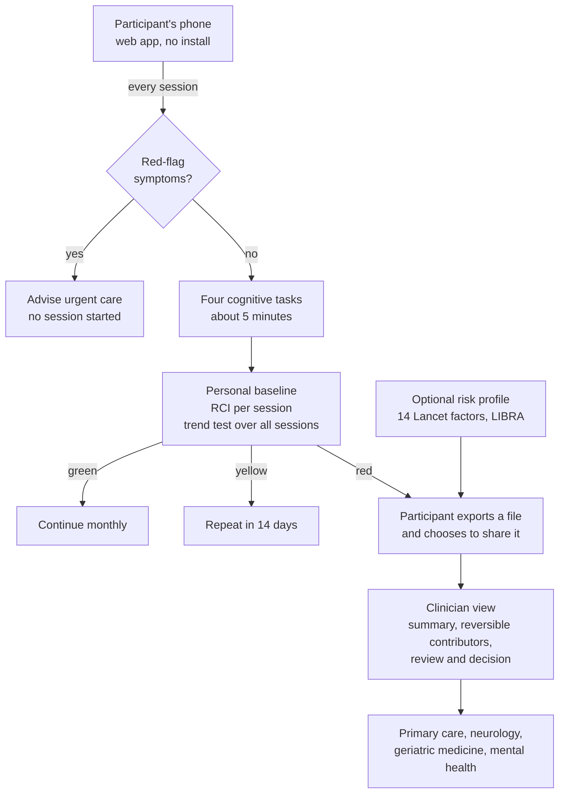
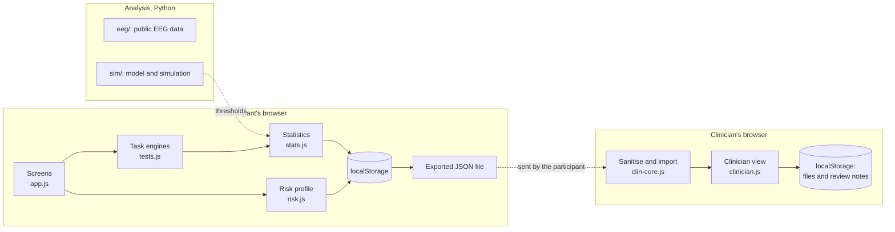

# NeuroBaseline — technical documentation

**Future Health Digital Innovation Challenge · Challenge 08, "Protecting Brain Health Earlier"**

| | |
|---|---|
| Team | Braincore |
| Team lead and contact | DO NGOC QUOC DUY, dnqduy.0611@gmail.com |
| Members | DO NGOC QUOC DUY (individual entry, one member) |
| Document version | 1.5, 13 November 2026 (see [revision history](#revision-history)) |
| Repository | https://github.com/dnqduy0611-source/neurobaseline |
| Hosted prototype | https://dnqduy0611-source.github.io/neurobaseline/ |

> NeuroBaseline is a research prototype for screening and monitoring. It makes no diagnosis and is not a medical device.

## Revision history

| Version | Date | Changes |
|---|---|---|
| 1.0 | 11 November 2026 | First complete version: participant app, risk context, clinician view, EEG analysis on public data, simulation study. |
| 1.1 | 11 November 2026 | Added the analysis of fixed cut-offs and education in NHANES 2011–2014 (section 7.3) and what it means for the simulation's assumptions. |
| 1.2 | 12 November 2026 | Change of device: detection and a new baseline period (sections 6.3, 10 and 12). Backup and restore, with checks on the file (section 5). Example profile reachable from the first screen. |
| 1.3 | 12 November 2026 | Interface and accessibility (section 6.10). A report of difficulty seeing or tapping reaches the clinician view. Hosted prototype and repository added. 71 automated tests. |
| 1.4 | 12 November 2026 | Simulation extended with a Kalman filter, baselines that keep adapting, and noise that lasts for weeks (sections 7.2, 8, 12 and 14). Offline only; the rule in the app is unchanged. 73 automated tests. |
| 1.5 | 13 November 2026 | Hours slept the night before are asked before each session and stored with it (section 6.2). Recorded only; no rule uses them. |

---

## Contents

1. [Summary](#1-summary)
2. [The problem and how the solution answers Challenge 08](#2-the-problem-and-how-the-solution-answers-challenge-08)
3. [Solution overview](#3-solution-overview)
4. [Maturity: what is built](#4-maturity-what-is-built)
5. [Architecture](#5-architecture)
6. [Methods](#6-methods)
7. [Evidence](#7-evidence)
8. [Responsible AI, safety and data governance](#8-responsible-ai-safety-and-data-governance)
9. [Data sources](#9-data-sources)
10. [Assumptions](#10-assumptions)
11. [Dependencies](#11-dependencies)
12. [Limitations](#12-limitations)
13. [Scalability and deployment readiness](#13-scalability-and-deployment-readiness)
14. [Path to pilot](#14-path-to-pilot)
15. [How to review the prototype](#15-how-to-review-the-prototype)
16. [References](#16-references)

---

## 1. Summary

**Idea.** Compare each person with themselves. A five-minute set of cognitive tasks on a phone is repeated over time. The system learns the person's own baseline and raises a flag only when a change is larger than that person's normal variation, or when the whole history shows a downward trend. It never compares one score with a population cut-off.

**Why.** The challenge statement names the failure of one-off scores: they are shaped by language, education, culture and familiarity with digital tools, and they produce false positives and false reassurance. A personal baseline removes those between-person differences by construction.

**Three tiers, from cheap and frequent to costly and rare.**

| Tier | Who | What | Status |
|---|---|---|---|
| 1 | Everyone enrolled, monthly | Four cognitive tasks, personal baseline, Reliable Change Index, trend test | Working web app |
| 2 | People at risk or flagged | Self-reported risk context (14 Lancet factors, LIBRA); resting EEG from a consumer headband | Risk context working. EEG: recording-file import and analysis working in the app, checked on public recordings; no live headband connection |
| 3 | People whose result reaches a threshold | Clinician review with a structured summary and a prompt list of reversible contributors | Working clinician view |

**What the evidence shows so far.**

- *Public EEG data (88 people).* The theta/alpha ratio alone separates Alzheimer's disease from healthy controls with AUC 0.87 (95 % CI 0.78–0.95). With only four channels at consumer-headband positions the AUC is 0.87–0.88. A machine-learning classifier did not improve on that single ratio.
- *Simulation (10 000 simulated people per cohort, 36 months).* With every method tuned to the same false-referral rate of 5 %, a fixed cut-off wrongly refers stable people with low education four times as often as those with high education (8.9 % vs 2.1 %); personal-baseline methods refer all education groups equally. The rule built into the app finds 80 % of slow decliners within 24 months at a 5.8 % false-referral rate. A baseline that keeps adapting to new sessions absorbs the decline it should detect (29 % found against a fixed baseline, 4–15 % against adaptive ones).
- *National survey data (NHANES 2011–2014, 3011 adults aged 60 and over).* On a standard symbol–digit test, college graduates score 2.2 SDs above people who did not finish 9th grade at the same age and sex. A single cut-off that flags 5 % of people with no memory complaint flags 40.2 % of the least schooled and 0.7 % of college graduates.
- *Software.* 73 automated tests pass (61 for the app, 12 for the model).

**What it does not show.** No real person has been followed over time with this system. The EEG data are cross-sectional and from clinical electrodes. The simulation rests on assumed parameters. Section 12 lists the limits in full.

---

## 2. The problem and how the solution answers Challenge 08

The challenge asks for technology that identifies meaningful changes in cognitive and functional health over time, integrates risk factors, and translates findings into culturally appropriate prevention and timely care.

| # | "Your solution should" | How NeuroBaseline answers | Status |
|---|---|---|---|
| 1 | Culturally valid and accessible assessment | Tasks use shapes, colours, symbols and pictures, not words. Each person is compared with themselves, so education and language do not set the threshold. Interface in English and Vietnamese, built to add languages (including right-to-left). Large type and touch targets. | Built. Arabic and audio instructions are not built. Tasks are not yet culturally validated. |
| 2 | Longitudinal change detection with clear thresholds | Personal baseline from a two-week burst of sessions; Reliable Change Index per session; a trend test over all sessions; explicit yellow (repeat in 14 days) and red (clinical review) rules. | Built. Thresholds come from simulation. |
| 3 | Integrated risk context | Optional, separately consented profile: the 14 modifiable factors of the 2024 Lancet Commission, the LIBRA index, sleep and family history. Shown next to any flag and in the clinician summary. | Built from self-report. No link to clinical, wearable or genomic records. |
| 4 | Personalised prevention and timely care | One plain-language action per risk factor present, taken from the Lancet Commission's recommendations. The clinician view suggests reversible contributors to check and records a referral decision. | Built. |
| 5 | Safety and human oversight | Red-flag questions before every session stop the session and advise urgent care. Every result is labelled screening, not diagnosis. A red status states that a clinician decides. Every flag shows its reason. | Built. A red light is not withheld until a clinician has reviewed it (needs a server). |
| 6 | Validation and local population performance | Simulation with sensitivity, false-referral rate, time to detection and fairness by education; EEG analysis on public data; a pilot protocol with the measures the challenge lists. | Simulation and public-data analysis done. No validation in the local population. |

---

## 3. Solution overview



**A participant's path.**

1. *Day 1.* Chooses a language, reads a short consent, gives an age group, education level and writing hand. Receives a random code. Does a warm-up session.
2. *Weeks 1–2.* Four more sessions, two or three days apart. These form the personal baseline.
3. *Monthly.* One five-minute session. The app shows green, yellow or red with the reason in plain words.
4. *Optional.* A three-minute risk profile shows which modifiable risk factors apply and what to do about each.
5. *If red.* The app says a change was confirmed, that this is not a diagnosis, and offers to prepare a file for a doctor.

**The clinician's path.** Imports the file. Sees who needs attention first, why, the trajectories, the risk context and a prompt list of reversible contributors. Records a review and a decision.

---

## 4. Maturity: what is built

Everything described here was built during the challenge. Nothing existed before registration.

| Component | State | Where |
|---|---|---|
| Participant web app: onboarding, consent, four tasks, schedule, storage, export | Working | `app/index.html`, `app/js/` |
| Personal baseline, Reliable Change Index, trend test, status rules | Working, unit-tested | `app/js/stats.js` |
| Risk profile (Lancet 14 factors, LIBRA, PHQ-2) | Working, unit-tested | `app/js/risk.js` |
| Clinician view: priority list, summary, checklist, review record, safe file import | Working, unit-tested | `app/clinician.html`, `app/js/clin-core.js` |
| Demo profile and simulated cohort | Working, labelled as simulated | `app/js/demo.js`, `app/js/demo-cohort.js` |
| EEG signal processing and analysis on public data | Offline scripts, results reported | `eeg/` |
| Hierarchical (population → individual) model | Offline, unit-tested; the population part is not in the app | `sim/model.py` |
| Simulation study of six detection methods | Offline, results reported | `sim/` |
| Kalman filter and adaptive baselines compared with the trend test | Offline, unit-tested, results reported; not in the app | `sim/kalman.py`, `sim/run_kalman.py`, `sim/stress_kalman.py` |
| Analysis of NHANES 2011–2014: fixed cut-offs and education | Offline, results reported | `nhanes/` |
| EEG in the app: recording-file import, analysis in the browser, personal EEG baseline | Working, unit-tested against the Python pipeline | `app/js/eeg-core.js`, `app/js/eeg-ui.js` |
| Live Bluetooth connection to a headband | Not built. A simulated stream that plays a recorded file shows the intended flow | – |
| Server, accounts, integration with health records or wearables | Not built | – |
| Arabic interface, audio instructions | Not built | – |
| Validation in real people | Not started | – |

---

## 5. Architecture



- **No server and no build step.** The app is static HTML, CSS and JavaScript with no third-party libraries. It can be served from any static host.
- **Data stay on the device.** Sessions are stored in the browser's `localStorage`. Nothing is transmitted. The participant exports a JSON file and decides whom to send it to. A full backup can be saved and restored in the same or another browser; a backup file is treated as untrusted input, its structure is checked and markup characters are removed before it replaces the stored data (`backup.js`).
- **One statistics module, two consumers.** `stats.js` is a pure module used by both the participant app and the clinician view, and it runs under Node.js for unit tests.
- **Imported files are untrusted.** The clinician view keeps only known fields with expected types and escapes every value before display.
- **Analysis is separate.** The Python code in `eeg/` and `sim/` produces evidence and thresholds. It is not part of the running app.

Repository map:

| Path | Content |
|---|---|
| `app/` | Participant app and clinician view |
| `app/tests/` | Unit tests (Node.js) |
| `eeg/` | EEG analysis on OpenNeuro ds004504; `REPORT.md` |
| `sim/` | Hierarchical model, simulation study, Kalman filter comparison; `REPORT.md` |
| `nhanes/` | Fixed cut-offs and education in NHANES 2011–2014; `REPORT.md` |
| `docs/` | This document |

---

## 6. Methods

### 6.1 Cognitive tasks

One session has five parts and takes about five minutes.

| Part | Task | Parameters | Measure |
|---|---|---|---|
| 1 | Picture memory, study | 8 pictures, 2 s each | – |
| 2 | Simple reaction time | 20 trials, random foreperiod 1–3 s, timeout 2 s | Median reaction time of valid trials (100–1500 ms) |
| 3 | Go/NoGo | 48 trials, 25 % NoGo, stimulus 500 ms, response window 900 ms | Commission errors (%) |
| 4 | Symbol–digit matching | 90 s, nine symbols, on-screen keypad | Number correct |
| 5 | Picture memory, delayed recognition | 16 pictures: 8 studied, 8 new from the same categories | Hits minus false alarms |

- The symbol key and the picture set change every session (seeded alternate forms).
- Stimulus onset is time-stamped inside `requestAnimationFrame`. Responses use `pointerdown` and the event's high-resolution timestamp.
- If the page is hidden during a task, that part is aborted and repeated.
- The tasks are adapted from established paradigms. Symbol–digit tasks are sensitive, though not specific, to cognitive change [16]. This implementation has not been validated against standard neuropsychological instruments.

Reaction time, symbol matching and picture memory are **primary indicators**. Go/NoGo commission errors are a **supporting indicator**: displayed, never able to change the status alone, because evidence for Go/NoGo in early decline is less consistent.

### 6.2 Schedule

- Sessions 1–5 in the first two weeks (a measurement burst). Repeated brief assessments are more reliable than a single one [11], and practice effects are largest over the first sessions [19]. Session 1 is familiarisation and is never scored.
- Sessions 2–5 form the baseline (n = 4). A session reported as an unusual day is not used and is replaced by the next.
- Hours slept the night before (five bands, self-reported) are stored with each session so that the share of session-to-session noise explained by sleep can be estimated in the pilot. They do not mark a day as unusual and no rule uses them.
- Then one session a month. After a yellow status the next session is due in 14 days.

### 6.3 Personal baseline and Reliable Change Index

For each indicator and each follow-up session:

```
RCI    = d × (x − m) / S_diff
S_diff = σ_w × √(1 + 1/n)
```

`x` is the session value, `m` the mean of the n baseline sessions, `d` is +1 when a higher value is worse and −1 otherwise, and `σ_w` is the within-person standard deviation between sessions. This follows Jacobson and Truax [1], with the baseline taken as a mean of n sessions.

`σ_w` starts from a prior and moves toward the person's own variability as stable sessions accumulate:

```
σ_w² = (ν₀ × σ₀² + (k − 1) × s²) / (ν₀ + k − 1)        ν₀ = 6
```

`σ₀` is the prior, `s²` the variance of the person's `k` stable sessions.

**Change of device.** Reaction times include the delay of the screen and of the touch hardware, so a baseline belongs to one device. Each session records the operating system family, the screen size and the input type. When these differ from the sessions of the current baseline, the participant chooses between going back to the usual device, declaring the device unchanged, or starting a new baseline period of four sessions. Sessions from an earlier period are kept and shown, but take no part in the comparison or in the trend test. With a device that adds 60 ms and no new baseline, every later session in a test history was flagged.

### 6.4 Trend test

A slow decline is easier to see in the whole history than in one session. For a candidate onset time τ, each primary indicator is modelled as

```
x(t) = level + slope × max(0, t − τ)
```

Level and slope are estimated together by least squares over all sessions, so that an error in the baseline is not mistaken for a decline. With r = max(0, t − τ) and W sessions:

```
t_k   = d × (Σ r·x − Σr · Σx / W) / (σ_w × √(Σ r² − (Σr)² / W))
trend = max over τ of  (Σ_k t_k) / √K
```

K is the number of primary indicators with enough data (at least two sessions after τ). Values are capped at 3 σ_w from the baseline. Sessions reported as an unusual day are left out.

A cumulative-sum scheme [2] against a fixed baseline was tried first and rejected: any error in the baseline accumulates at every session (section 7.2).

### 6.5 Status rules

| Status | Rule | Action |
|---|---|---|
| Green | No primary indicator beyond RCI 1.96, and trend below 3.0 | Continue monthly |
| Yellow | Any primary indicator beyond RCI 1.96, or trend ≥ 3.0 | Repeat in 14 days |
| Red | The same primary indicator beyond RCI 3.0 on two consecutive sessions; or two primary indicators beyond RCI 3.0 in one session that was not reported as an unusual day; or trend ≥ 3.5 | Clinical review advised |
| Urgent | "Yes" to any red-flag question before a session | No session; urgent care advised |

The red limits were chosen in the simulation study for a false-referral rate near 5 % over three years (section 7.2). Improvement never raises a flag. Every yellow or red status lists its reason.

### 6.6 Risk context

An optional questionnaire of about three minutes with its own consent. Any question may be left blank.

- **Lancet Commission 2024** [3]: the 14 potentially modifiable risk factors, each classified as present, managed, absent or not answered. Each present factor carries one action taken from the Commission's recommendations. Air pollution is not asked.
- **LIBRA index** [4]: twelve factors with published weights, range −5.9 to +12.7. Shown to clinicians with every item. No category is assigned because the index has no agreed cut-offs.
- **PHQ-2** [5] stands in for a depression diagnosis (positive at 3 or more). PHQ-9 was not used because the app has no safe pathway for its self-harm item.
- The rationale for acting on several factors at once is the FINGER trial, in which a multidomain intervention improved cognition in at-risk older adults [18].
- Sleep duration, snoring and family history are recorded as context and never scored. The Commission states that the evidence on sleep does not yet support a recommendation [3].

### 6.7 Hierarchical model (offline)

For one indicator:

```
score[person, session] = population prediction (age, education) + practice effect (session number)
                       + person's level ~ N(0, σ_b²) + session noise ~ N(0, σ_w²)
```

The population part is learned from a reference sample. For a person with n sessions of mean ȳ:

```
baseline = w × ȳ + (1 − w) × population prediction        w = n / (n + k),  k = σ_w² / σ_b²
```

With n = 0 the person is compared with people of the same age and education; as n grows, with their own history. The RCI of section 6.3 is the case k = 0. This follows the logic of normative modelling [6]; correcting individual change scores for practice is established in neuropsychology [12]. The population part is **not in the app**, because norms for these tasks do not exist yet.

### 6.8 EEG processing (offline)

Slowing of the resting EEG is a long-established finding in Alzheimer's disease [13], and the individual alpha frequency is a stable trait within a person [14]. These two facts are the rationale for following a person's own EEG over time.

A pipeline simple enough to run on a phone: band-pass 1–40 Hz; re-reference; 4-second epochs; reject epochs beyond 200 µV peak to peak; Hann-windowed periodogram averaged over epochs [7]; relative band powers, theta/alpha ratio, and alpha centre of gravity over 6–13 Hz [8]. No independent component analysis and no manual cleaning.

**In the app.** The participant records three minutes at rest with eyes closed, saves the recording as a CSV file with the headband's own software, and selects that file. The app reads a plain layout (a time column and one column per channel) and a Mind Monitor-style layout (`TimeStamp`, `RAW_TP9`, …), at 128, 200, 250, 256, 500 or 512 Hz. The analysis runs in the browser and only the resulting numbers are kept; the signal is never stored. A recording needs at least 60 seconds of clean signal. The first two usable recordings of a device type form a personal EEG baseline; later recordings get a z value for log(theta/alpha) and for the alpha centre of gravity, using an assumed day-to-day SD. A slower rhythm is reported to the participant in plain words and shown to the clinician with its z values. **EEG does not enter the status rule.** Three sample recordings and a simulated headband stream, both derived from the public dataset and labelled as such, let a reviewer try the flow without a device; they are never saved to the participant's record.

Headbands are emulated by re-referencing clinical recordings to a forehead (Fpz) reference, which both manufacturers state their devices use, and keeping only the nearest 10–20 positions (section 7.1). One of the two devices has a published validation for research use [17].

### 6.9 Clinician view

Participants are ordered by: red-flag report not yet reviewed; red not yet reviewed; yellow; overdue; red reviewed; green; baseline phase. The detail page shows the indicators against the baseline, the trend statistic and its contributions, trajectories, the session log with reported context, the risk context, twelve prompts for potentially reversible contributors, and a review record. A prompt is marked when the participant's own answers point to it; for example, reported diabetes prompts vitamin B12 and glucose, and reported snoring prompts sleep-disordered breathing. New data after a review mark the review as out of date. The prompt list is consistent with guidance to carry out blood and urine tests to exclude reversible causes of cognitive decline [15].

### 6.10 Interface and accessibility

The interface outside the tasks follows the settings of the person's device. The task screens do not, because their appearance is part of the measurement.

| Aspect | What the app does |
|---|---|
| Text size | Interface text is sized relative to the browser's base size, and to Dynamic Type on iOS. At 150 % and 200 % on a 360 × 640 screen there is no horizontal overflow; instruction screens scroll. |
| Motion | With "reduce motion" set, animations and transitions are off and answers no longer advance on their own. The 90-second timer bar of the symbol task keeps moving, because it is the only cue of the time left. |
| Dark theme | Applies to every screen except the tasks. Task screens keep a light background and the same stimulus colours and sizes in both themes (17 elements compared, identical). |
| Contrast and size | Text is at least 4.5:1 against its background and at least 12 px. Measured on 12 participant screens and 2 clinician screens in each theme. |
| Screen readers | Controls have names, changes of status are announced through a live region, tables in the clinician view have captions and row and column headers, and charts carry a text label. |
| Colour | Status is always given in words as well as colour. In the Go/No-Go task the two stimuli differ in shape as well as colour (green circle, red square). |
| Who cannot take the tasks | Before every session the app states that the tasks need a clear view of the screen and accurate tapping. A person who reports difficulty gets no session and no score, and the report is shown in the clinician view. |

Not done: no test with a screen reader on a phone (TalkBack, VoiceOver), none with the operating system's own text-size setting, and none with people who have low vision or tremor. The tasks cannot be taken without sight and hand control; the app says so and offers no alternative task.

---

## 7. Evidence

### 7.1 EEG on public data

**Data.** OpenNeuro ds004504 [9]: resting, eyes-closed, 19-channel clinical EEG from 36 people with Alzheimer's disease (AD), 23 with frontotemporal dementia (FTD) and 29 healthy controls (CN). Full report: [`eeg/REPORT.md`](../eeg/REPORT.md).

| Feature, AD vs CN | 19 channels | BrainBit-like, 4 channels | Muse-like, 4 channels |
|---|---|---|---|
| Theta/alpha ratio, AUC (95 % CI) | 0.87 (0.78–0.95) | 0.88 (0.78–0.96) | 0.87 (0.78–0.95) |
| Alpha centre of gravity, AUC (95 % CI) | 0.80 (0.68–0.90) | 0.80 (0.68–0.91) | 0.82 (0.70–0.92) |
| Logistic regression, 6 features, leave-one-subject-out | 0.84 (0.73–0.93) | 0.84 (0.73–0.92) | 0.83 (0.72–0.92) |

- The theta/alpha ratio also separates FTD from controls (AUC 0.82, 0.70–0.92). The alpha frequency does not (0.62, 0.46–0.77).
- The classifier is better than chance (permutation p = 0.005) but not better than the ratio alone, so no classifier is used in the decision path.
- Two halves of one recording agree closely for alpha frequency (ICC 0.995–0.997). The first three minutes agree with the full recording (ICC 0.97).
- Simple cleaning agrees with the dataset authors' ICA-cleaned data (ICC 0.97–1.00 for alpha frequency).
- The groups overlap: 12 of 36 AD patients have a ratio inside the control range.

**Limits.** Established dementia (mean MMSE 17.8 in AD), not early change. One recording per person. Clinical gel electrodes; "headband-like" refers to electrode position only. One site, 88 people, no external validation.

### 7.2 Simulation study

**Design.** Simulated people take five burst sessions and then monthly sessions for 36 months; 80 % are stable, 15 % decline slowly (0.5 SD per year on the most affected indicator), 5 % drop suddenly. Six ways of raising a referral follow the same people. Each is tuned so that 5 % of stable people are referred. Eight cohorts of 10 000. Full report: [`sim/REPORT.md`](../sim/REPORT.md).

| Method | Slow decline found within 24 months | Sudden drop found within 6 months | False referrals, low vs high education |
|---|---|---|---|
| Fixed cut-off | 10 % | 9 % | 8.9 % vs 2.1 % |
| Age- and education-adjusted cut-off | 11 % | 10 % | 5.1 % vs 4.8 % |
| Personal baseline (RCI) | 27 % | 23 % | 5.0 % vs 5.0 % |
| Hierarchical model | 32 % | 29 % | 5.0 % vs 5.1 % |
| Hierarchical model + cumulative sum | 44 % | 3 % | 4.9 % vs 5.1 % |
| Hierarchical model + trend test | 76 % | 65 % | 5.0 % vs 4.9 % |

- **Fairness.** A fixed cut-off over-refers stable people with low education and misses decliners with high education. Adjusted norms repair this only when the norms fit the population: with norms learned in a different population the adjusted cut-off gave 7.1 % vs 3.0 %, while personal methods stayed between 4.6 % and 5.5 %.
- **Time.** Slow decline takes time to find with any method. The best method finds 9 % within 12 months of onset, 34 % within 18 and 76 % within 24; the median delay is 20 months.
- **Sensitivity to assumptions.** The ranking of methods is the same in all seven scenarios. Absolute detection varies widely: 19 % with a decline half as fast, 38 % with less reliable tasks.

**The rule built into the app**, run in the same simulation without population norms or practice correction:

| Rule | Stable people referred in 36 months | Slow decline found within 12 / 18 / 24 months | Sudden drop found within 6 months |
|---|---|---|---|
| First version: red on a repeated change beyond RCI 1.96 | 18.3 % | 18 % / 38 % / 62 % | 54 % |
| Current: section 6.5 | 5.8 % | 10 % / 41 % / 80 % | 66 % |

**A Kalman filter, and baselines that keep adapting** (added in version 1.4; [`sim/REPORT.md`](../sim/REPORT.md) section 8). Would a state-space model do better than the trend test, and what happens when the baseline itself keeps learning? The Kalman filter tracks a level and a slope for each indicator; after the five burst sessions its level is exactly the hierarchical baseline of section 6.7. Its one free parameter, how much the slope may change per month, was chosen on a separate tuning cohort. The adaptive baselines compare each session with a running mean of all earlier sessions, or with a filter that also forgets older sessions. Same cohorts as above, every method tuned to 5 % false referrals.

| Method | Slow decline found within 12 / 18 / 24 months | Sudden drop found within 6 months |
|---|---|---|
| Trend test (in the app) | 9 % / 34 % / 76 % | 65 % |
| Kalman filter (level and slope) | 4 % / 50 % / 90 % | 10 % |
| Trend test or Kalman filter | 6 % / 44 % / 88 % | 53 % |
| One session against the fixed burst baseline | 5 % / 13 % / 29 % | 30 % |
| One session against a running mean of all sessions | 4 % / 9 % / 15 % | 19 % |
| One session against a baseline that forgets older sessions | 3 % / 4 % / 5 % | 11 % |

- **The Kalman filter finds more slow decline** (+14.8 points within 24 months; +12.6 to +16.9 across the eight cohorts), and more still when the tasks are less reliable (65 % vs 38 %) or the decline is slower (39 % vs 19 %). It pays with sudden drops and with the first year, because it assumes that a slope changes slowly. Used together with the trend test it keeps most of both.
- **A baseline that keeps adapting absorbs the decline it should detect.** The more a baseline learns from recent sessions, the less it finds. This is why the app fixes the baseline after the burst and reads change from a trend that estimates level and slope together.
- **Noise that lasts for weeks.** With thresholds set under independent noise, a month-to-month correlation of 0.3 raises false referrals from 5 % to 9.7 % for the trend test and for the Kalman filter alike; a correlation of 0.5 raises them to 14.1 % and 14.6 %. Detection within 24 months stays at 76 % for the trend test and falls from 90 % to 85 % for the Kalman filter.
- **Not in the app.** The simulated decline is a straight line that never stops, which is the shape this filter expects, so the gain may be smaller on real trajectories. The filter is a candidate for the pilot (section 14), with its parameter set from real data.

**Limits.** The generating parameters are assumptions. Session noise is independent between sessions and between indicators, which favours the trend test; real spells of poor sleep or illness would raise its false-referral rate (quantified above). Decline is linear. The trend test was added after the first results showed that single-session rules found few slow decliners, and the Kalman filter later still; neither was pre-specified.

### 7.3 Fixed cut-offs and education in national survey data

**Data.** NHANES 2011–2014 [20]: 3011 adults aged 60 and over with a Digit Symbol Substitution Test (DSST) score and a known education level; 2569 of them report no worsening confusion or memory loss. Survey-weighted, design-based estimates. Full report: [`nhanes/REPORT.md`](../nhanes/REPORT.md).

| Education | Mean DSST score (95 % CI) | Flagged by one cut-off set at 5 % overall | Flagged by norms adjusted for age, sex and education |
|---|---|---|---|
| Less than 9th grade | 28.0 (25.3–30.8) | 40.2 % (32.0–49.1) | 3.4 % |
| 9th–11th grade | 40.6 (38.7–42.4) | 11.5 % | 5.4 % |
| High school or GED | 48.5 (46.6–50.4) | 4.0 % | 5.9 % |
| Some college | 55.0 (53.7–56.2) | 1.7 % | 5.1 % |
| College graduate | 59.4 (57.9–61.0) | 0.7 % (0.3–1.3) | 4.4 % |

The two flagging columns are for people who report no worsening of memory.

- At the same age and sex, college graduates score 29.5 points above people who did not finish 9th grade: 2.2 residual SDs, or the difference associated with 33 years of age.
- Among people aged 60–69 with no memory complaint, 74.2 % of the least schooled and 2.8 % of college graduates fall below the lowest-quartile cut-off often used to define low cognitive performance.
- The simulation assumed an education gap of 1.0 SD between its extreme levels. The real gap on this test is larger, so the simulated unfairness of a fixed cut-off is conservative.

**Limits.** NHANES has no clinical assessment of cognition, and less schooling is itself a risk factor for dementia, so part of the excess among the least schooled may be real impairment; the data cannot say how much. The DSST is a two-minute paper test in a US sample, not this app's task. The data are cross-sectional. Adjusted norms were evaluated in the sample they were fitted on.

### 7.4 Software verification

| Suite | Tests | Covers |
|---|---|---|
| `app/tests/stats.test.js` | 26 | Task summaries, baseline, RCI, trend test, status rules, schedule, device key, new baseline period |
| `app/tests/risk.test.js` | 11 | Factor classification, LIBRA range, BMI, PHQ-2 |
| `app/tests/clin.test.js` | 10 | File sanitisation, priority order, review logic, checklist prompts, baseline period, reported access difficulty |
| `app/tests/backup.test.js` | 6 | Acceptance of a valid backup, refusal of foreign, demo and damaged files, removal of markup |
| `app/tests/eeg.test.js` | 8 | Reading recording files, agreement with the Python pipeline, rejection of poor recordings, personal EEG baseline |
| `sim/test_model.py` | 12 | Parameter recovery, shrinkage limits, trend test, calibration, Kalman filter against the hierarchical baseline, adaptive baselines |

The in-app EEG processing reproduces the Python pipeline on six real recordings: relative band powers within 0.01, theta/alpha ratio within 3 %, alpha centre of gravity within 0.03 Hz.

A QA robot (`index.html?qa=1`) plays complete sessions automatically. It was used to run a full history through green, yellow and red.

### 7.5 What has not been validated

- No session has been completed by a study participant. Reliability, practice effects and completion rates of these tasks are unknown.
- The app has not been tested on a range of phones.
- No comparison with a reference neuropsychological assessment.
- No data from the intended population.

---

## 8. Responsible AI, safety and data governance

**Screening, not diagnosis.** Stated on every result screen and in the clinician view. A red status says that a threshold was reached and that a qualified clinician decides what happens next.

**Safety before analysis.** Four red-flag questions precede every session. Any "yes" stops the session, advises urgent care, and is shown first in the clinician's list.

**Explainable by design.** Every flag is produced by two named statistics and shows its reason: the indicator, the value, the person's usual level and the limit, or the areas that carry a trend. Machine learning was tested where it could help (EEG classification) and left out of the decision path when it did not outperform a single interpretable ratio.

**Learning from personal data, with a fixed point of comparison.** The system learns each person's usual level and variability from their own sessions. It does not let that baseline drift with every new session: in simulation a baseline that keeps adapting found 4–15 % of slow decliners where a fixed one found 29 % (section 7.2). More flexible models are compared offline first, and none enters the status rule without data from real people.

**Fairness measured, not assumed.** False-referral and detection rates are reported by education level, including the case where norms come from another population.

**Uncertainty disclosed.** Thresholds, priors and accuracy limits are documented. Simulated data carry a label on every screen and figure.

**Privacy by design.**

| Principle | Implementation |
|---|---|
| Explicit consent | Consent before enrolment; a second consent for the risk profile |
| Data minimisation | Age group, education level and writing hand only; no name, no contact details, no health record |
| Pseudonymity | A random code generated on the device |
| Local processing | All computation and storage in the browser; nothing transmitted |
| EEG | Analysed on the device; only derived numbers are kept, never the signal |
| User-controlled sharing | The participant exports a file and chooses the recipient; the risk profile and the EEG results are each excluded unless a box is ticked |
| Erasure | "Delete all my data" removes everything from the device |

**Cultural considerations.** Tasks avoid words. Alcohol is asked with "None" as the first option and may be left blank. The app never advises anyone to drink, although LIBRA counts low-to-moderate alcohol use as protective. Picture sets avoid alcohol, pork and religious symbols. Family history is optional, and genetic results are not collected.

**Human oversight, and its gap.** The clinician view records a review and a decision. The participant sees a red status at once; withholding it until review would need a server.

**Security.** Imported files are sanitised and escaped. The app loads no third-party code.

---

## 9. Data sources

| Source | Use | Licence or terms | Personal data |
|---|---|---|---|
| OpenNeuro ds004504 [9] | EEG analysis (`eeg/`) | CC0 | De-identified research data; the full dataset is not redistributed in this repository |
| Six sample recordings (`app/samples/`) | Demonstration and tests of the in-app EEG check | Derived from ds004504 (CC0): three participants, re-referenced to Fpz, resampled, first three minutes | De-identified research data |
| NHANES 2011–2012 and 2013–2014 [20]: demographics, cognitive functioning and medical conditions files | Analysis of cut-offs and education (`nhanes/`) | US public-use data, public domain | De-identified survey data; not redistributed in this repository |
| Simulated cohorts | Simulation study (`sim/`) | Generated by the team's code | None |
| Simulated demo profile and cohort | Demonstration in the app and clinician view | Generated by the team's code | None; fictional people |
| Lancet Commission 2024 [3] | List of risk factors and recommendations | Published report, cited | – |
| LIBRA weights [4, 10] | Risk index | Published weights, cited | – |
| PHQ-2 [5] | Two screening questions | The PHQ forms state that no permission is required to reproduce, translate, display or distribute them | – |

No data were collected from people during the challenge. The organisers provided no data.

---

## 10. Assumptions

| Assumption | Value | Used in | To be replaced by |
|---|---|---|---|
| Prior within-person SD, reaction time | 25 ms | RCI, trend test | Pilot measurement |
| Prior within-person SD, symbol matching | 4 items | RCI, trend test | Pilot measurement |
| Prior within-person SD, picture memory | 1.2 points | RCI, trend test | Pilot measurement |
| Prior within-person SD, commission errors | 8 percentage points | RCI | Pilot measurement |
| Weight of the prior | 6 pseudo-sessions | RCI, trend test | Review after pilot |
| Yellow limit | RCI 1.96 | Status rule | Kept (95 % two-sided) |
| Red limits | RCI 3.0; trend 3.0 and 3.5 | Status rule | Calibration on real follow-up data |
| Day-to-day SD of log(theta/alpha) | 0.20 | EEG z values | Repeated-day recordings with a real headband |
| Day-to-day SD of the alpha centre of gravity | 0.20 Hz | EEG z values | Repeated-day recordings with a real headband |
| Recordings forming the EEG baseline | 2 | EEG z values | Review after the headband sub-study |
| Session scores roughly normal and independent | – | RCI, trend test | Checked in pilot; autocorrelation modelled if present |
| Practice effect negligible after session 5 | – | App (no correction) | Practice curve from pilot; correction as in `sim/model.py` |
| Simulation parameters (reliability 0.70 / 0.85 / 0.60; decline 0.5 SD per year; 8 % unusual days) | See `sim/README.md` | Simulation study | Literature review and pilot |
| Social isolation means contact less than weekly | – | Risk profile | Agreed definition |
| Excessive alcohol means more than 12 drinks a week | Lancet: more than 21 UK units | Risk profile | – |
| Headband electrodes sit at the nearest 10–20 positions | AF7 and AF8 from Fp and F7/F8; TP9 and TP10 as T5 and T6; Fpz as the mean of Fp1 and Fp2 | EEG analysis | Real device recordings |
| One device per participant | The app compares operating system, screen size and input type with the sessions of the current baseline; on a change the participant goes back to the usual device or starts a new baseline | All timing measures | Device calibration; devices of the same model cannot be told apart |

---

## 11. Dependencies

**Participant app and clinician view**

- A modern browser with Pointer Events and `localStorage` (current Chrome, Safari, Edge, Firefox).
- Any static web host, or a local web server.
- The device's own emoji font for the memory pictures.
- No third-party libraries, no network services, no accounts.

**Tests**

- Node.js for the JavaScript unit tests.

**Analysis**

- Python 3 with NumPy, SciPy, pandas, scikit-learn and Matplotlib.
- The public dataset ds004504 (5.8 GB), downloaded by `eeg/download_data.py`.

**Outside the software**

- A clinician to review flagged results.
- For Tier 2 EEG: a consumer headband with posterior or temporal electrodes. No device has been tested.
- For deployment: a hosting environment, a consent and data-protection framework, and a regulatory assessment.

---

## 12. Limitations

**Evidence**

1. No longitudinal data from real people. The central claim, that following a person against their own baseline detects decline earlier, is supported by simulation only. The claim that fixed cut-offs sort people by schooling now has real cross-sectional support (section 7.3), but those data cannot tell real impairment from bias.
2. The EEG analysis compares established dementia with healthy controls, between people, on clinical electrodes. It does not show that a headband can track change within a person.
3. Simulation results depend on assumed parameters. Detection within 24 months ranged from 19 % to 100 % across scenarios.
4. Thresholds were chosen in simulation and are untested on real data.

**Method**

5. Slow decline is slow to detect: a median of about 20 months in the main simulation scenario.
6. The trend test can mistake a spell of poor sleep or illness lasting weeks for decline. Reported unusual days are excluded; unreported ones are not. In simulation a month-to-month noise correlation of 0.3 roughly doubled false referrals (5 % to 9.7 %); the real correlation is unknown.
7. The app has no practice correction and no population norms, so it cannot judge the very first sessions.
8. Picture memory is likely to be near ceiling in healthy adults, which limits its reliability.
9. Reaction times depend on the device. The app detects a change of operating system, screen size or input type and offers to start a new baseline of four sessions; sessions from the earlier device are kept but no longer compared. Two devices of the same model cannot be told apart, the participant can declare the device unchanged, and a new baseline costs about two weeks without monitoring.
10. The trend test was introduced after seeing first simulation results, and the Kalman filter comparison after that. The Kalman filter is not in the app, and its advantage rests on a simulated decline that is exactly linear.

**Product**

11. The app reads recording files; it does not connect to a headband. The Mind Monitor-style layout follows the format's published description and has not been tried with a file from a real device. No headband has been used at any point.
12. No server: files are passed by hand, review notes live in one browser, and a red status is shown before clinician review.
13. Risk factors are single self-report questions standing in for validated instruments and records. LIBRA has no agreed cut-offs.
14. The checklist of reversible contributors reflects general clinical practice and has not been checked against a local guideline.
15. English and Vietnamese only. The Vietnamese PHQ-2 wording is the team's own translation. No Arabic, no audio instructions.
16. Not tested across phones, with older adults, with a screen reader, or with people who have sensory or motor impairment.
17. Not a certified medical device. No regulatory assessment has been made.

---

## 13. Scalability and deployment readiness

**What scales as it is.** Tier 1 is static files with on-device computation. Serving more participants adds no computing cost, and no personal data are held centrally.

**What deployment would need.**

| Need | Why |
|---|---|
| A secure server with consent management | Reminders, clinician review before disclosure, continuity when a phone is replaced |
| Integration with existing screening pathways | The challenge statement notes that cognitive screening and a broader wellness model already exist; NeuroBaseline is meant to add longitudinal follow-up to them, not replace them |
| Arabic and other local languages, audio instructions | Accessibility for the intended population |
| Local norms and reliability data | To enable the population part of the hierarchical model and to recalibrate thresholds |
| Device calibration | To allow a change of phone |
| Regulatory and clinical-safety assessment | Software that informs referral decisions is likely to fall under medical-device rules |
| Headband selection and validation | Tier 2 EEG has not been tested on any device |

**Cost structure.** Tier 1 needs only hosting and support. Tier 2 EEG adds a reusable consumer device per site or per household. Tier 3 uses existing clinical time, which the false-referral rate directly determines. No quantitative cost or market analysis has been done.

---

## 14. Path to pilot

| Stage | Question | Design | Measures |
|---|---|---|---|
| 0. Reliability pilot | Are the tasks usable and stable? | 20–30 adult volunteers, five sessions in two weeks, plus one run with the non-writing hand as a known change | Completion, session duration, test–retest reliability, within-person SD, practice curve, detection of the known change |
| 1. Normative and reliability study | How do scores vary with age, education and language in the intended population? | Stratified sample, Arabic and English, three months | Norms, reliability by subgroup, false-referral rate in people presumed stable, month-to-month correlation of session noise |
| 2. Prospective accuracy study | Does a red status correspond to clinically confirmed change? | Primary-care cohort aged 50 and over, 12–24 months, reference neuropsychological assessment for flagged people and a sample of unflagged people | Sensitivity, specificity, ability to identify meaningful change, false-referral burden, time to clinical assessment, all by language, age and education; trend test and Kalman filter compared on the same trajectories |
| 2b. Headband sub-study | Is a headband stable enough within a person? | Repeated 3-minute recordings over weeks in a subset | Test–retest reliability and within-person SD of the theta/alpha ratio and alpha frequency; signal-quality failure rate |

Sample sizes for stages 1 and 2 will be set from the reliability and within-person SD measured in stage 0. Each stage has a stopping rule: if stage 0 shows test–retest reliability too low for individual change detection, the tasks are redesigned before stage 1.

---

## 15. How to review the prototype

The prototype is hosted at https://dnqduy0611-source.github.io/neurobaseline/ . The page links to the example profile, the participant app and the clinician view; nothing needs to be installed and there is no login.

To run it locally instead, serve the `app/` folder and open it in a browser:

```bash
cd app
python -m http.server 8080
```

| To see | Open |
|---|---|
| The participant app from the start | `http://localhost:8080/` |
| Ten months of simulated history ending in a red status | `http://localhost:8080/index.html?demo=1` |
| The clinician view | `http://localhost:8080/clinician.html`, then "Load simulated cohort" |
| The EEG check on real recordings | In the participant app: "Brain-rhythm check", then a sample recording or the simulated headband |
| A complete session played automatically (shortened) | `http://localhost:8080/index.html?qa=1&fast=1` |

Run the tests:

```bash
cd app
node tests/stats.test.js
node tests/risk.test.js
node tests/clin.test.js
node tests/eeg.test.js
node tests/backup.test.js
```

```bash
cd sim
python test_model.py
```

Further reading: [`README.md`](../README.md), [`eeg/REPORT.md`](../eeg/REPORT.md), [`sim/REPORT.md`](../sim/REPORT.md), [`nhanes/REPORT.md`](../nhanes/REPORT.md).

---

## 16. References

All entries were checked against Crossref, PubMed or the publisher's page.

1. Jacobson NS, Truax P. Clinical significance: a statistical approach to defining meaningful change in psychotherapy research. *J Consult Clin Psychol.* 1991;59(1):12–19. doi:10.1037/0022-006X.59.1.12
2. Page ES. Continuous inspection schemes. *Biometrika.* 1954;41(1–2):100–115. doi:10.1093/biomet/41.1-2.100
3. Livingston G, Huntley J, Liu KY, et al. Dementia prevention, intervention, and care: 2024 report of the Lancet standing Commission. *Lancet.* 2024;404(10452):572–628. doi:10.1016/S0140-6736(24)01296-0
4. Deckers K, van Boxtel MPJ, Schiepers OJG, et al. Target risk factors for dementia prevention: a systematic review and Delphi consensus study on the evidence from observational studies. *Int J Geriatr Psychiatry.* 2015;30(3):234–246. doi:10.1002/gps.4245
5. Kroenke K, Spitzer RL, Williams JBW. The Patient Health Questionnaire-2: validity of a two-item depression screener. *Med Care.* 2003;41(11):1284–1292. doi:10.1097/01.MLR.0000093487.78664.3C
6. Marquand AF, Rezek I, Buitelaar J, Beckmann CF. Understanding heterogeneity in clinical cohorts using normative models: beyond case-control studies. *Biol Psychiatry.* 2016;80(7):552–561. doi:10.1016/j.biopsych.2015.12.023
7. Welch P. The use of fast Fourier transform for the estimation of power spectra: a method based on time averaging over short, modified periodograms. *IEEE Trans Audio Electroacoust.* 1967;15(2):70–73. doi:10.1109/TAU.1967.1161901
8. Klimesch W. EEG alpha and theta oscillations reflect cognitive and memory performance: a review and analysis. *Brain Res Rev.* 1999;29(2–3):169–195. doi:10.1016/S0165-0173(98)00056-3
9. Miltiadous A, Tzimourta KD, Afrantou T, et al. A dataset of scalp EEG recordings of Alzheimer's disease, frontotemporal dementia and healthy subjects from routine EEG. *Data.* 2023;8(6):95. doi:10.3390/data8060095. Dataset: OpenNeuro ds004504, doi:10.18112/openneuro.ds004504.v1.0.9
10. O'Donnell CA, Browne S, Pierce M, et al. Reducing dementia risk by targeting modifiable risk factors in mid-life: study protocol for the Innovative Midlife Intervention for Dementia Deterrence (In-MINDD) randomised controlled feasibility trial. *Pilot Feasibility Stud.* 2015;1:40. doi:10.1186/s40814-015-0035-x
11. Sliwinski MJ, Mogle JA, Hyun J, et al. Reliability and validity of ambulatory cognitive assessments. *Assessment.* 2018;25(1):14–30. doi:10.1177/1073191116643164
12. Chelune GJ, Naugle RI, Lüders H, Sedlak J, Awad IA. Individual change after epilepsy surgery: practice effects and base-rate information. *Neuropsychology.* 1993;7(1):41–52. doi:10.1037/0894-4105.7.1.41
13. Jeong J. EEG dynamics in patients with Alzheimer's disease. *Clin Neurophysiol.* 2004;115(7):1490–1505. doi:10.1016/j.clinph.2004.01.001
14. Grandy TH, Werkle-Bergner M, Chicherio C, et al. Peak individual alpha frequency qualifies as a stable neurophysiological trait marker in healthy younger and older adults. *Psychophysiology.* 2013;50(6):570–582. doi:10.1111/psyp.12043
15. National Institute for Health and Care Excellence. Dementia: assessment, management and support for people living with dementia and their carers. NICE guideline NG97. 2018. https://www.nice.org.uk/guidance/ng97
16. Jaeger J. Digit Symbol Substitution Test: the case for sensitivity over specificity in neuropsychological testing. *J Clin Psychopharmacol.* 2018;38(5):513–519. doi:10.1097/JCP.0000000000000941
17. Krigolson OE, Williams CC, Norton A, et al. Choosing MUSE: validation of a low-cost, portable EEG system for ERP research. *Front Neurosci.* 2017;11:109. doi:10.3389/fnins.2017.00109
18. Ngandu T, Lehtisalo J, Solomon A, et al. A 2 year multidomain intervention of diet, exercise, cognitive training, and vascular risk monitoring versus control to prevent cognitive decline in at-risk elderly people (FINGER): a randomised controlled trial. *Lancet.* 2015;385(9984):2255–2263. doi:10.1016/S0140-6736(15)60461-5
19. Falleti MG, Maruff P, Collie A, Darby DG. Practice effects associated with the repeated assessment of cognitive function using the CogState battery at 10-minute, one week and one month test-retest intervals. *J Clin Exp Neuropsychol.* 2006;28(7):1095–1112. doi:10.1080/13803390500205718
20. Centers for Disease Control and Prevention, National Center for Health Statistics. National Health and Nutrition Examination Survey data, 2011–2012 and 2013–2014. Hyattsville, MD: US Department of Health and Human Services. https://wwwn.cdc.gov/nchs/nhanes/
