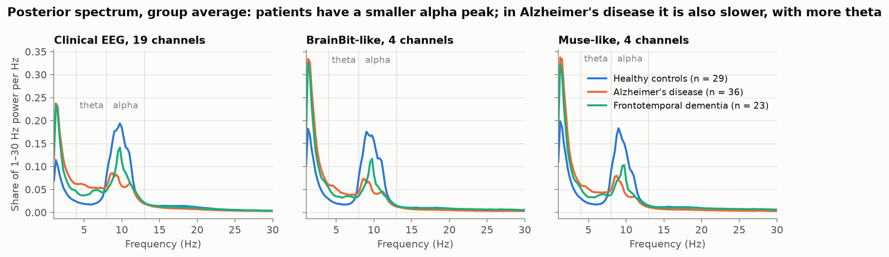
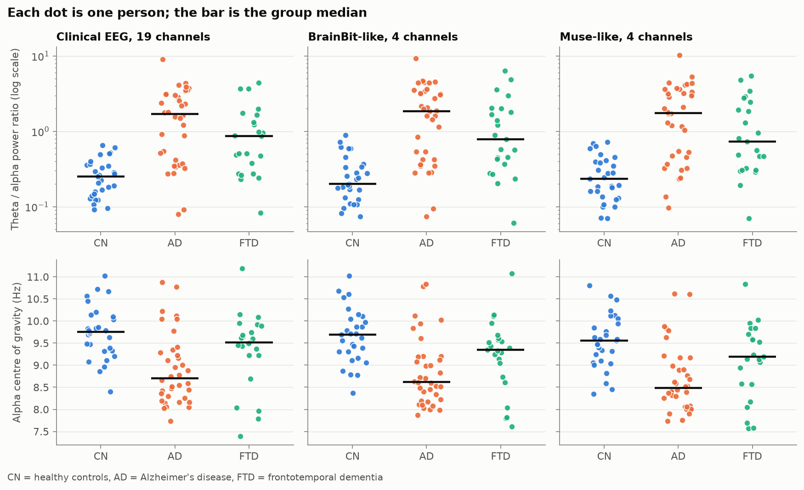
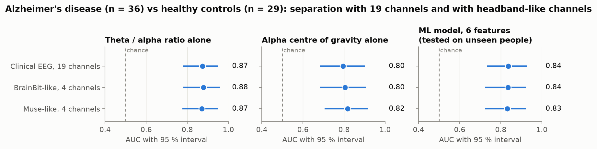
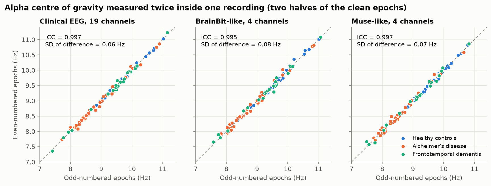
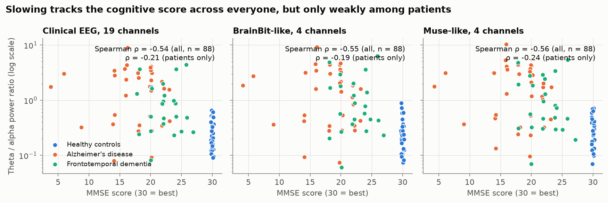

# EEG analysis report

**Question.** Can a few channels of resting EEG, processed with a pipeline simple enough for a phone, carry the signal that the NeuroBaseline headband layer needs?

**Data.** OpenNeuro ds004504 (CC0): 36 people with Alzheimer's disease (AD), 23 with frontotemporal dementia (FTD), 29 healthy controls (CN). Eyes closed, 19-channel clinical EEG, about 12–14 minutes each. Mean age 66.4, 63.7 and 67.9 years; mean MMSE 17.8, 22.2 and 30.0.

**Method.** See [`README.md`](README.md). Every number below is copied from [`results/tables.md`](results/tables.md) or `results/summary.json`.

## Summary

| | Result |
|---|---|
| Theta/alpha ratio alone, AD vs controls, 19 channels | AUC 0.87 (95 % interval 0.78–0.95) |
| Same, BrainBit-like 4 channels | AUC 0.88 (0.78–0.96) |
| Same, Muse-like 4 channels | AUC 0.87 (0.78–0.95) |
| Small ML model on unseen people, 19 channels | AUC 0.84 (0.73–0.93); no better than the ratio alone |
| Two halves of one recording, alpha frequency | ICC 0.995–0.997; differ by 0.06–0.08 Hz (SD) |
| First 3 minutes vs the whole recording, alpha frequency | ICC 0.97; median difference about 0.1 Hz |
| Our simple cleaning vs the authors' ICA cleaning, same person | ICC 0.97–1.00 for alpha frequency |

In this dataset, four headband-position channels separated patients from controls as well as nineteen channels did, and a three-minute recording gave almost the same values as the full one.

## 1. Simple features separate patients from controls

Healthy controls show a clear alpha peak near 10 Hz. In AD the peak is smaller and lower in frequency, with more theta power. In FTD the peak is smaller but sits at about the same frequency.

| 19 channels, raw data | Controls (median) | AD (median) | AUC, AD vs CN | FTD (median) | AUC, FTD vs CN |
|---|---|---|---|---|---|
| Theta/alpha ratio | 0.25 | 1.69 | 0.87 (0.78–0.95) | 0.87 | 0.82 (0.70–0.92) |
| Alpha centre of gravity | 9.75 Hz | 8.70 Hz | 0.80 (0.68–0.90) | 9.51 Hz | 0.62 (0.46–0.77) |

- The theta/alpha ratio separates both patient groups from controls.
- The alpha frequency separates AD from controls, but **not FTD**: its interval includes 0.5 (chance).
- The groups overlap. 12 of the 36 AD patients (33 %) and 11 of the 23 FTD patients (48 %) have a ratio inside the range of the controls (up to 0.66). This is a risk signal, not a diagnosis.

## 2. Headband-position channels keep the separation

| AD vs CN | Theta/alpha ratio | Alpha centre of gravity |
|---|---|---|
| Clinical EEG, 19 channels | 0.87 (0.78–0.95) | 0.80 (0.68–0.90) |
| BrainBit-like, 4 channels | 0.88 (0.78–0.96) | 0.80 (0.68–0.91) |
| Muse-like, 4 channels | 0.87 (0.78–0.95) | 0.82 (0.70–0.92) |

No loss is visible. With 65 people the intervals are wide, so this shows "no detectable loss", not proven equivalence. The likely reason is that the slowing in dementia is widespread over the scalp, so a few well-placed channels see it.

Signal quality was similar across sets: a median of 96 % of epochs kept, and all 88 recordings usable.

## 3. A machine-learning model adds nothing here

Logistic regression on six features, leave-one-subject-out (each person scored by a model trained on the others):

| AD vs CN, raw data | AUC | Sensitivity | Specificity |
|---|---|---|---|
| Clinical EEG, 19 channels | 0.84 (0.73–0.93) | 72 % | 79 % |
| BrainBit-like, 4 channels | 0.84 (0.73–0.92) | 72 % | 76 % |
| Muse-like, 4 channels | 0.83 (0.72–0.92) | 72 % | 69 % |

- The model is clearly better than chance (label-permutation test, p = 0.005, the smallest value 200 permutations can give).
- It is **not better than the theta/alpha ratio alone** (0.84 vs 0.87). A random forest gave 0.83, 0.84 and 0.78.
- Consequence for the product: the EEG layer can use one or two named, explainable numbers. A black-box classifier is not needed in the decision path.

For dementia of either type vs controls the model reached 0.83 (0.74–0.90), and for FTD vs controls 0.79 (0.65–0.90), on 19 channels.

## 4. One short recording is precise

| Raw data | Split-half ICC | SD of the difference between halves | 3 min vs full recording: ICC | 3 min vs full: median difference |
|---|---|---|---|---|
| Alpha centre of gravity, 19 channels | 0.997 | 0.060 Hz | 0.975 | 0.100 Hz |
| Alpha centre of gravity, BrainBit-like | 0.995 | 0.078 Hz | 0.967 | 0.111 Hz |
| Alpha centre of gravity, Muse-like | 0.997 | 0.066 Hz | 0.970 | 0.093 Hz |

For scale: people differ from each other by about 0.8 Hz (SD), and the AD and control medians are about 1 Hz apart. The measurement noise inside one sitting is more than ten times smaller.

This is a ceiling, not a test–retest result. The two halves are interleaved epochs of the same sitting, so they share the person's state on that day. How much the value moves from day to day, and with a dry-electrode headband, is not measured here.

## 5. Simple cleaning is enough for these features

Per-person agreement between our pipeline on the raw recordings and the same features computed on the authors' ICA-cleaned data:

| | Alpha centre of gravity: ICC | Median difference |
|---|---|---|
| Clinical EEG, 19 channels | 0.996 | 0.017 Hz |
| BrainBit-like, 4 channels | 0.968 | 0.053 Hz |
| Muse-like, 4 channels | 0.971 | 0.059 Hz |

Group separation was also nearly the same on the cleaned data (theta/alpha ratio, AD vs CN: 0.88, 0.89 and 0.88).

## 6. Relation to cognitive score

Across all 88 people the theta/alpha ratio correlates with MMSE (Spearman ρ = −0.54). Among patients only it does not reach significance (ρ = −0.21, p = 0.11, n = 59). In this sample the ratio tells patients from controls; it is not shown to grade severity.

## What this does and does not show

**It supports** three design choices: a theta/alpha ratio and an alpha frequency as the EEG indicators; a handful of channels at headband positions; a three-minute eyes-closed recording with threshold-based cleaning.

**It does not show** that the product works. The limits are large:

1. **Late, not early.** The patients have established dementia (mean MMSE 17.8 in AD). Separating them from healthy people is far easier than noticing an early change, which is what NeuroBaseline is for.
2. **Between people, not within a person.** The data are one recording per person. Nothing here tests the core idea of following one person against their own baseline.
3. **Clinical electrodes.** "Headband-like" means electrode positions only. The signals come from gel electrodes applied by technicians in a clinic. Dry electrodes at home will be noisier.
4. **One site, 88 people.** No external validation set. Intervals are wide.
5. **No adjustment** for age, sex or medication. Group ages are similar. Among controls the ratio tends to rise with age (ρ = 0.32, p = 0.09).
6. **Position approximations.** Fpz is approximated by Fp1 and Fp2, AF7/AF8 by neighbouring electrodes, TP9/TP10 by T5/T6.
7. **Two primary features** were fixed in advance. The other features in `summary.json` are exploratory and uncorrected for multiple testing.

## Consequences for the design

- Use the **theta/alpha ratio as the first EEG indicator** and alpha frequency as the second. The design document listed alpha frequency first; the ratio also covers FTD.
- Keep the EEG decision **explainable**: named features and a personal baseline, no classifier.
- The next evidence needed is **test–retest across days with a real headband**, which gives the within-person SD that the Reliable Change Index requires.
