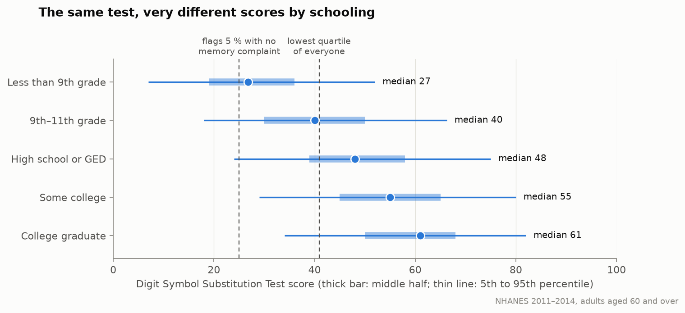
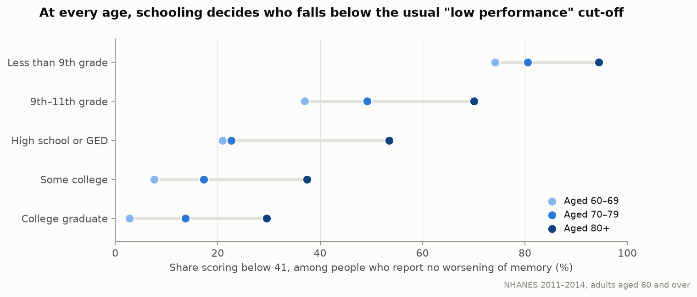
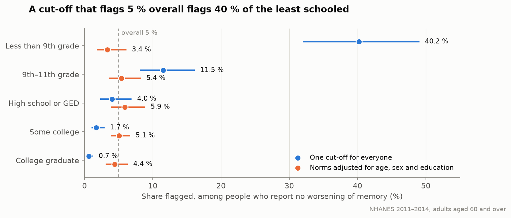

# What a fixed cut-off does to people with different schooling: NHANES 2011–2014

**Question.** NeuroBaseline compares each person with themselves because one cut-off for everyone is said to be unfair to people with less schooling. The simulation study shows this under assumptions. Does it show in real data?

**Data.** The US National Health and Nutrition Examination Survey, cycles 2011–2012 and 2013–2014. Adults aged 60 and over took the Digit Symbol Substitution Test (DSST), a paper test of processing speed and attention scored as the number of correct symbols in two minutes. 3011 people have a score and a known education level; 2569 of them reported no worsening confusion or memory loss in the past 12 months. Estimates use the survey weights and design.

**Method.** See [`README.md`](README.md). Every number below is copied from [`results/tables.md`](results/tables.md).

## Summary

| | Result |
|---|---|
| Mean score, college graduates vs less than 9th grade | 59.4 vs 28.0 |
| The same gap at equal age and sex | 29.5 points, 2.2 residual SDs |
| … expressed as the difference associated with age | 33 years |
| A cut-off that flags 5 % of people with no memory complaint: least schooled vs college graduates | 40.2 % vs 0.7 % flagged |
| The same 5 % with norms adjusted for age, sex and education | 3.4 % vs 4.4 % flagged |

One cut-off for everyone sorts people mainly by schooling. A cut-off that flags 5 % of the population flags two in five of the people who did not finish 9th grade and fewer than one in a hundred college graduates, among people who report no worsening of memory.

## 1. Scores differ greatly by schooling

| Education | n | Mean (95 % CI) | SD | 5th–95th percentile |
|---|---|---|---|---|
| Less than 9th grade | 347 | 28.0 (25.3–30.8) | 13.6 | 7–52 |
| 9th–11th grade | 427 | 40.6 (38.7–42.4) | 14.0 | 18–66 |
| High school or GED | 702 | 48.5 (46.6–50.4) | 15.0 | 24–75 |
| Some college | 843 | 55.0 (53.7–56.2) | 15.2 | 29–80 |
| College graduate | 692 | 59.4 (57.9–61.0) | 14.5 | 34–82 |

At the same age and sex, each step up in education adds points: +11.7, +19.1, +24.8 and +29.5 relative to the lowest level. One year of age costs 0.90 points. The gap between the highest and lowest education levels therefore equals the difference associated with 33 years of age.

## 2. A fixed cut-off divides people by schooling

A common convention in studies of these data is to call the lowest quartile "low cognitive performance". Here that is a score below 40.9.

Share scoring below 40.9 among people who report no worsening of memory:

| Education | All ages | Aged 60–69 | Aged 70–79 | Aged 80+ |
|---|---|---|---|---|
| Less than 9th grade | 80.4 % (72.6–86.4) | 74.2 % | 80.5 % | 94.4 % |
| 9th–11th grade | 46.5 % | 37.0 % | 49.2 % | 70.1 % |
| High school or GED | 26.8 % | 21.0 % | 22.6 % | 53.5 % |
| Some college | 13.9 % | 7.6 % | 17.3 % | 37.4 % |
| College graduate | 8.5 % (6.4–11.3) | 2.8 % | 13.7 % | 29.6 % |

Among people in their sixties with no memory complaint, three in four of those with the least schooling fall below this cut-off, and about one in thirty-five college graduates.

## 3. At a 5 % flagging rate

The simulation study tuned every method to refer 5 % of stable people. The same exercise on real scores:

| Education | One cut-off for everyone (score below 25.0) | Norms adjusted for age, sex and education |
|---|---|---|
| Less than 9th grade | 40.2 % (32.0–49.1) | 3.4 % (1.8–6.1) |
| 9th–11th grade | 11.5 % | 5.4 % |
| High school or GED | 4.0 % | 5.9 % |
| Some college | 1.7 % | 5.1 % |
| College graduate | 0.7 % (0.3–1.3) | 4.4 % (3.1–6.3) |

- With one cut-off, almost everyone flagged comes from the two lowest education levels.
- Adjusted norms bring every level close to 5 %. They are fitted and applied in the same sample here, so this is the best case. The simulation showed what happens when norms come from a different population: the imbalance returns.

## 4. What this means for the simulation

The simulation assumed a gap of 1.0 between-person SD between the highest and lowest of three education levels on its symbol-matching task. In NHANES the gap between the extreme education levels on the DSST is 2.2 residual SDs, and between "high school" and "less than 9th grade" it is 1.4. The simulation's assumption was therefore conservative: the unfairness of a fixed cut-off that it reported (8.9 % vs 2.1 % false referrals) understates what real scores show.

## What this does and does not show

**It shows** that on a real, widely used test of the same kind as NeuroBaseline's symbol-matching task, schooling shifts scores by more than two standard deviations, so that any single cut-off mostly separates people by schooling.

**It does not show** how many of the people flagged are unimpaired. The limits:

1. **No diagnosis is available.** NHANES has no clinical assessment of cognition. Less schooling is also a real risk factor for dementia, so part of the excess among the least schooled reflects real impairment. Restricting to people who report no worsening of memory reduces this but cannot remove it. The size of the difference, and its presence at ages 60–69, make real impairment an unlikely full explanation, but the data cannot settle it.
2. **Schooling stands for more than schooling.** In these data it is tied to language, income, health and familiarity with timed paper tests. The analysis does not separate them.
3. **A different test and country.** The DSST here is a two-minute paper test given in the United States. NeuroBaseline's task is a 90-second touch-screen task. The direction of the result should carry over; the size may not.
4. **One time point.** The data say nothing about following a person against their own baseline. That claim still rests on the simulation.
5. **Adjusted norms were evaluated in the sample they were fitted on.**
6. Age is top-coded at 80. The memory question is self-reported.

## Consequence for the design

The case for a personal baseline does not depend on a modelling assumption about education. It appears in national survey data on a standard test. Where local, education-adjusted norms do not exist, as for a new touch-screen task in a new population, a personal baseline is the way to avoid sorting people by schooling.
