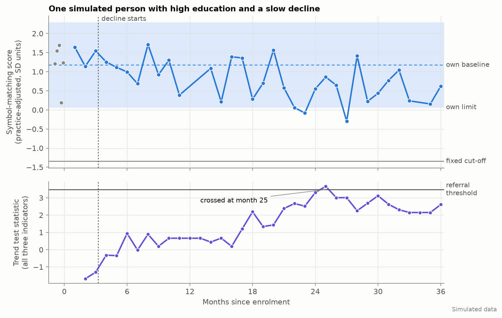
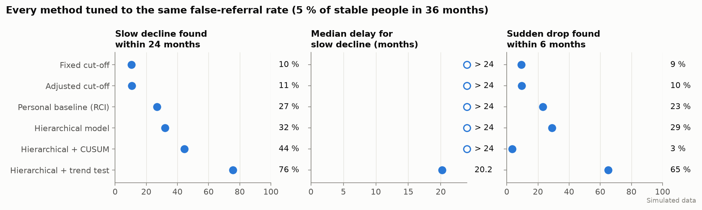
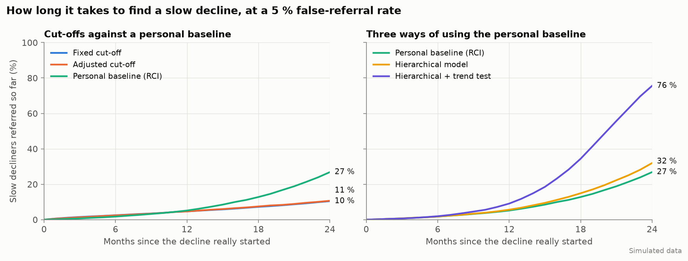
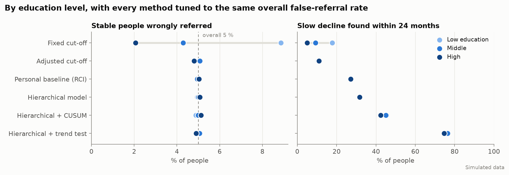
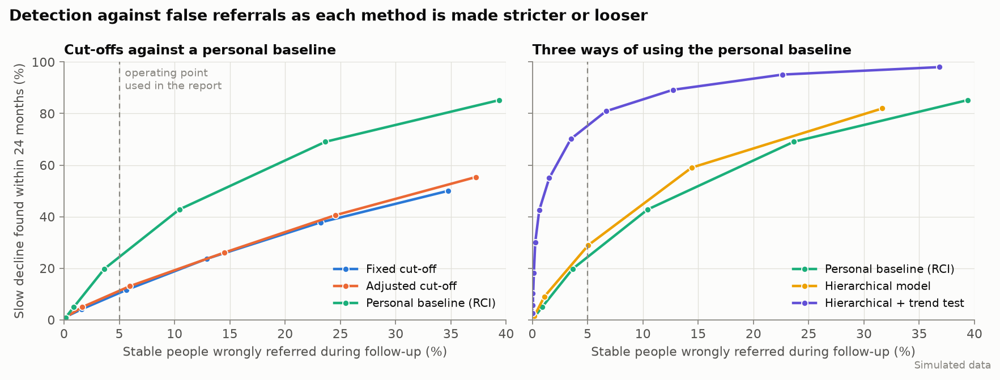
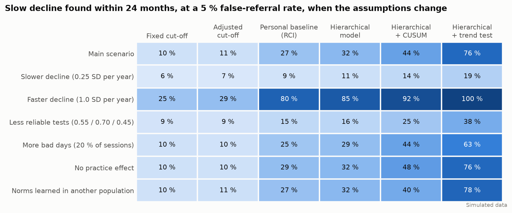

# Simulation report: personal baselines, a hierarchical model and a trend test

> **Everything in this report is simulated.** The people, their scores and their declines are generated by a program from stated assumptions. The results show what the methods do *if those assumptions hold*. They are not evidence of clinical effectiveness.

**Question.** When people take short cognitive tests every month, which way of deciding "this person should be referred" finds decline earliest and treats education groups equally?

**Method.** See [`README.md`](README.md). Six methods follow the same 10 000 simulated people for 36 months. Each method is tuned so that **5 % of stable people are referred** during that time, then compared on how many decliners it finds. Main scenario: 8 independent cohorts. Every number below is copied from [`results/tables.md`](results/tables.md).

## Summary

| Method | Slow decline found within 24 months | Sudden drop found within 6 months | False referrals, low vs high education |
|---|---|---|---|
| Fixed cut-off | 10 % | 9 % | 8.9 % vs 2.1 % |
| Age/education-adjusted cut-off | 11 % | 10 % | 5.1 % vs 4.8 % |
| Personal baseline (RCI), the app's current rule | 27 % | 23 % | 5.0 % vs 5.0 % |
| Hierarchical model | 32 % | 29 % | 5.0 % vs 5.1 % |
| Hierarchical model + CUSUM | 44 % | 3 % | 4.9 % vs 5.1 % |
| **Hierarchical model + trend test** | **76 %** | **65 %** | 5.0 % vs 4.9 % |

Three findings:

1. **Comparing people with themselves is fair; fixed cut-offs are not.** With one cut-off for everyone, stable people with low education are wrongly referred four times as often as those with high education.
2. **How the history is used matters more than the baseline itself.** A test that looks at the whole trend finds about three times as many slow decliners as the single-session rule the app uses today, at the same false-referral rate.
3. **Slow decline takes time to find, whatever the method.** Even the best method finds 9 % within 12 months of onset and 76 % within 24 months. The median delay is 20 months.

## 1. An example

A person with high education starts to decline at month 3. Their scores stay far above the fixed cut-off for the whole three years, so a cut-off never refers them. Single sessions dip below the personal limit now and then, but rarely twice in a row. The trend statistic, which uses all sessions and all three indicators, rises steadily and crosses its threshold at month 25.

## 2. Detection at the same false-referral rate

| Method | Slow decline found within 12 months | 18 months | 24 months | Median delay | Sudden drop within 3 months | 6 months |
|---|---|---|---|---|---|---|
| Fixed cut-off | 5 % | 7 % | 10 % | more than 24 months | 6 % | 9 % |
| Age/education-adjusted cut-off | 5 % | 7 % | 11 % | more than 24 months | 6 % | 10 % |
| Personal baseline (RCI) | 5 % | 13 % | 27 % | more than 24 months | 14 % | 23 % |
| Hierarchical model | 6 % | 15 % | 32 % | more than 24 months | 19 % | 29 % |
| Hierarchical model + CUSUM | 3 % | 15 % | 44 % | more than 24 months | 0 % | 3 % |
| Hierarchical model + trend test | 9 % | 34 % | 76 % | 20.2 months | 33 % | 65 % |

- **Cut-offs find little** because a decline of half an SD per year leaves most people above a cut-off that is 2.4 SD below the mean (the level needed to keep false referrals at 5 %).
- **The hierarchical model beats the plain RCI modestly** (32 % vs 27 %). It removes the practice effect and uses all five burst sessions.
- **The trend test is the large step** (76 %). It pools every session and all three indicators, and it estimates the level and the slope together.

### Why the CUSUM did poorly

The CUSUM was the first trend method tried. It adds up how far each session falls below the baseline. Any error in the baseline is then added again at every session, so stable people whose baseline happened to come out too high drift toward an alarm. To keep false referrals at 5 % its threshold has to be very high (about 15), which makes it slow, and nearly blind to a sudden drop within 6 months (3 %). The trend test avoids this by re-estimating the level from all sessions.

## 3. Fairness by education

| Method | Stable people wrongly referred: low education | middle | high | Slow decline found within 24 months: low | middle | high |
|---|---|---|---|---|---|---|
| Fixed cut-off | 8.9 % | 4.3 % | 2.1 % | 18 % | 9 % | 5 % |
| Age/education-adjusted cut-off | 5.1 % | 5.1 % | 4.8 % | 10 % | 11 % | 11 % |
| Personal baseline (RCI) | 5.0 % | 4.9 % | 5.0 % | 27 % | 27 % | 27 % |
| Hierarchical model + trend test | 5.0 % | 5.1 % | 4.9 % | 75 % | 76 % | 75 % |

The fixed cut-off is unfair in both directions: it over-refers stable people with low education and misses decliners with high education.

Adjusted norms repair this **only when the norms fit the population**. When the model was trained on one population and applied to another (lower scores, larger education gaps), the adjusted cut-off became unfair again, 7.1 % vs 3.0 % false referrals for low vs high education. The personal methods stayed between 4.6 % and 5.5 %. This matters for a setting where local norms do not exist yet.

## 4. The whole trade-off

The 5 % operating point is one choice. The ordering of the methods is the same along the whole curve.

At customary thresholds, without tuning:

| Method (threshold) | Stable people referred in 36 months | Slow decline found within 24 months | Sudden drop within 6 months |
|---|---|---|---|
| Fixed cut-off (1.5 SD) | 30.9 % | 45 % | 42 % |
| Personal baseline, the app's current rule (z = 1.96) | 18.3 % | 62 % | 54 % |
| Hierarchical model (z = 1.96) | 25.6 % | 77 % | 70 % |
| Hierarchical model + trend test (3.0) | 12.6 % | 88 % | 81 % |

With its current rule the app would give about one stable person in five a red light at least once in three years. That is a finding about the app as built, not only about the alternatives.

## 5. When the assumptions change

Slow decline found within 24 months, at 5 % false referrals:

| Scenario | Fixed cut-off | Personal baseline (RCI) | Hierarchical + trend test |
|---|---|---|---|
| Main scenario | 10 % | 27 % | 76 % |
| Slower decline (0.25 SD per year) | 6 % | 9 % | 19 % |
| Faster decline (1.0 SD per year) | 25 % | 80 % | 100 % |
| Less reliable tests | 9 % | 15 % | 38 % |
| More bad days (20 % of sessions) | 10 % | 25 % | 63 % |
| No practice effect | 10 % | 29 % | 76 % |
| Norms learned in another population | 10 % | 27 % | 78 % |

- **The ranking never changes.** The trend test is best in every scenario and cut-offs are worst.
- **The absolute numbers change a great deal.** Detection depends most on how fast the decline is and how reliable the tests are. A decline of a quarter of an SD per year is mostly missed within two years by every method.
- **Wrong norms do not hurt the personal methods.** After five sessions the person's own data carry 86–96 % of the weight.

**Check against real data.** The simulation assumes that the highest and lowest education groups differ by 1.0 between-person SD on symbol matching. In NHANES 2011–2014 the extreme education levels differ by 2.2 residual SDs on the Digit Symbol Substitution Test, and a cut-off flagging 5 % overall flags 40.2 % of the least schooled against 0.7 % of college graduates ([`nhanes/REPORT.md`](../nhanes/REPORT.md)). The simulated imbalance of 8.9 % vs 2.1 % is therefore conservative.

## 6. What the model learned

Fitted on a reference sample of 2000 stable people, compared with the values that generated the data:

| Quantity | Speed | Symbol matching | Memory |
|---|---|---|---|
| Between-person SD: true / learned | 1.00 / 0.98 | 1.00 / 0.99 | 1.00 / 0.99 |
| Within-person SD: true / learned | 0.72 / 0.72 | 0.46 / 0.47 | 0.90 / 0.90 |
| Age slope per year: true / learned | −0.03 / −0.03 | −0.03 / −0.03 | −0.03 / −0.03 |
| High vs low education: true / learned | 0.40 / 0.50 | 1.00 / 1.03 | 0.80 / 0.68 |
| k = within² / between² | 0.54 | 0.22 | 0.82 |
| Weight of the person's own data after 1 session | 0.65 | 0.82 | 0.55 |
| After 5 sessions | 0.90 | 0.96 | 0.86 |

The variance components and the age effect are recovered closely. The education effect is recovered less precisely (0.50 for a true 0.40; 0.68 for a true 0.80).

## 7. The rule built into the app

After this study the app's light logic was changed. `run_app_rule.py` runs the app's exact rule in the main scenario (8 cohorts of 10 000, [`results/app_rule.md`](results/app_rule.md)). Unlike the hierarchical model above, the app has no population norms and no practice correction.

| Rule in the app | Stable people referred in 36 months | Slow decline found within 12 months | 18 months | 24 months | Sudden drop within 3 months | 6 months |
|---|---|---|---|---|---|---|
| Earlier: single sessions only, red on a repeated change beyond z = 1.96 | 18.3 % | 18 % | 38 % | 62 % | 36 % | 54 % |
| Current: yellow beyond z = 1.96; red beyond z = 3.0 (repeated, or two indicators), or trend ≥ 3.5 | 5.8 % | 10 % | 41 % | 80 % | 39 % | 66 % |

- False referrals fall from 18.3 % to 5.8 %, and detection within 24 months rises from 62 % to 80 %.
- Detection within the first 12 months falls from 18 % to 10 %. The earlier rule found more early cases only because it referred three times as many people overall.
- False referrals are the same across education levels (5.9 %, 5.8 %, 5.8 %).
- The limits were chosen from a small grid of candidates on two cohorts and then checked on these eight. They were not tuned on real data.

## What this does and does not show

**It supports:** comparing people with themselves; correcting for practice; and judging the trend over all sessions, not one session at a time.

**It does not show** that any of this works in real people. Specific limits:

1. **The assumptions drive the numbers.** Reliability, decline rate, practice gain and the share of bad days are plausible guesses, not measurements. Section 5 shows how much the results move.
2. **Session noise is independent from one session to the next.** Real people have spells of poor sleep, illness or low mood that last weeks. That would look like a trend and would raise false referrals for the trend test in particular.
3. **Noise is independent between the three indicators**, apart from bad days. If one session's noise is shared across tasks, combining indicators gains less than simulated here.
4. **Decline is a straight line** from a single starting point. Real trajectories are irregular.
5. **Thresholds are tuned on the same cohort they are evaluated on.** This fixes the false-referral rate exactly; in practice it would have to be set in advance and would drift.
6. **The reference sample is large, healthy and followed for a year.** A real pilot will be much smaller.
7. **The trend test was added after the first results** showed that single-session rules and the CUSUM found few slow decliners. It is a sensible response, but it was not planned in advance, and its threshold has no customary value.
8. **Nobody drops out for good**, and people who decline are as likely to keep testing as people who do not.

## Consequences for the design

- **Keep the personal baseline.** It is what makes the system fair across education, and it does not depend on local norms.
- **Add the trend test to the app**, next to the yellow/red single-session rule. Done: see section 7.
- **Tighten the red-light rule.** Done: red now needs z = 3.0, not 1.96.
- **Say plainly how long detection takes.** With monthly five-minute sessions, a slow decline is found in about a year and a half to two years, not in months. Faster detection needs more reliable tasks or more frequent sessions; a cleverer rule alone will not do it.
- **Use the population model for two jobs only:** judging the very first sessions, and removing the practice effect. After five sessions it adds little.
- **Measure the two numbers that matter most in the pilot:** test–retest reliability and the within-person SD of each task.
